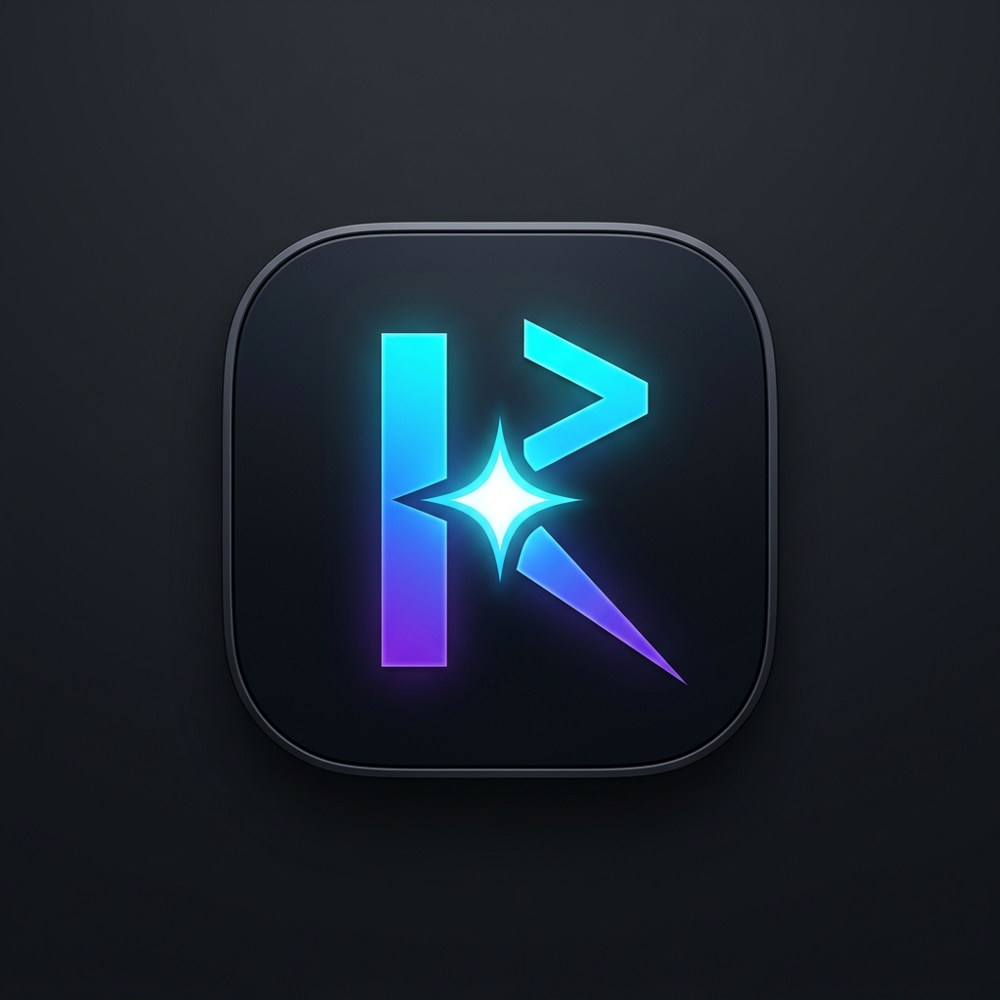
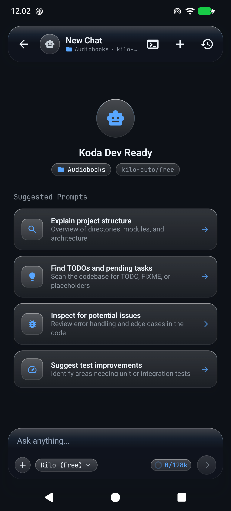
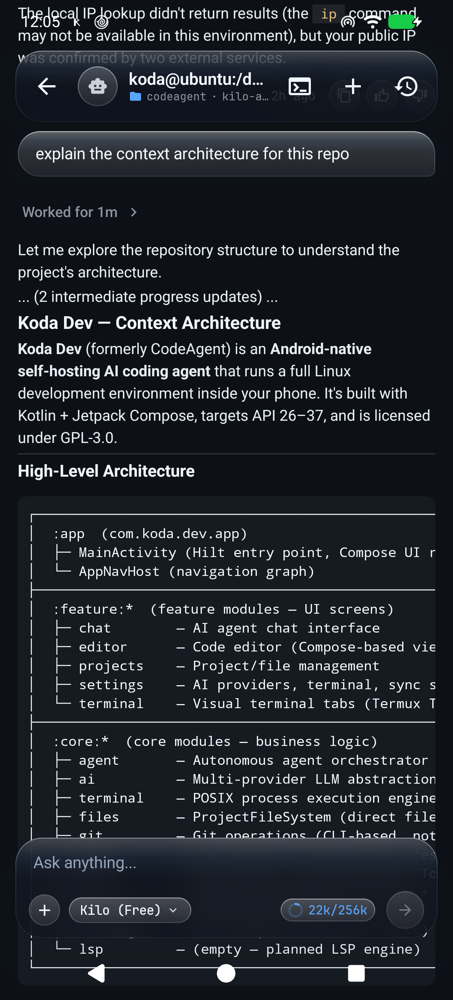
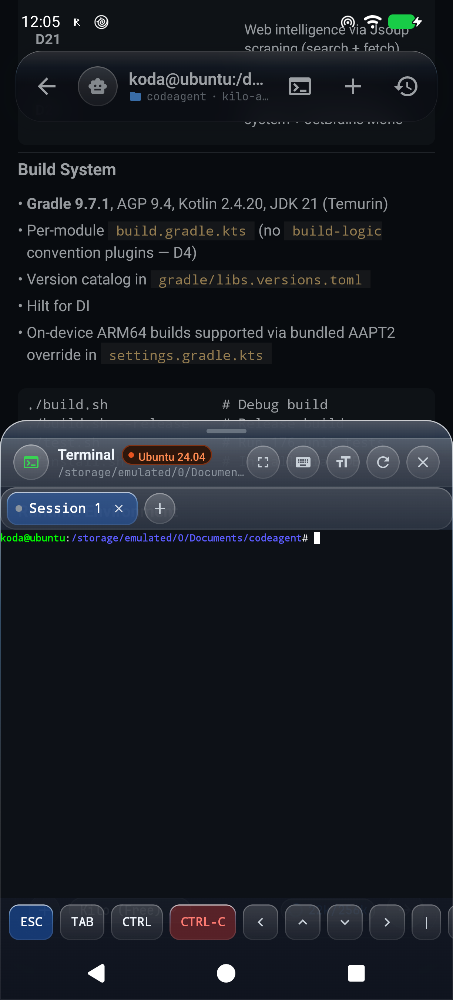
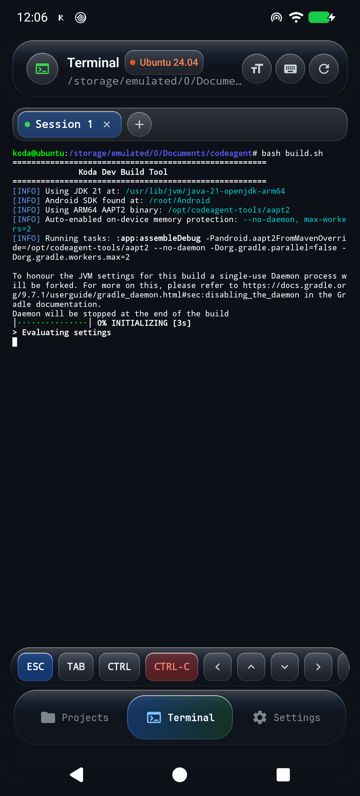
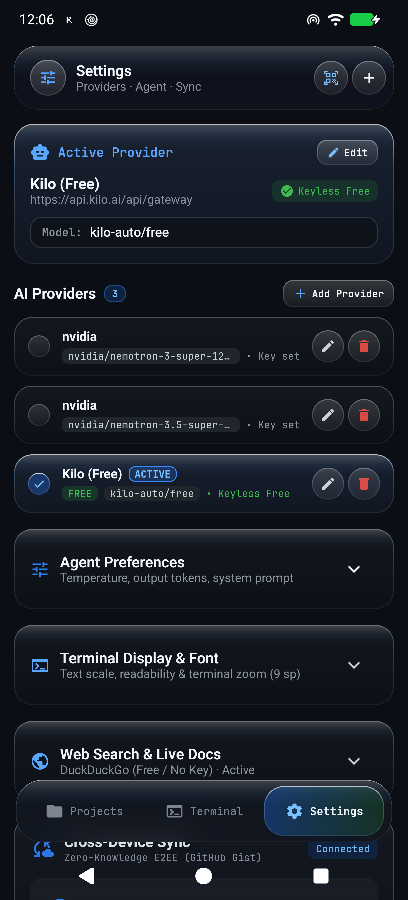

<p align="center">
  
</p>

<p align="center">
  
</p>

<h1 align="center">Koda Dev</h1>

<p align="center">
  <b>Android-Native Self-Hosting AI Coding Agent & Full Linux Development Environment</b>
</p>

<p align="center">
  <a href="https://github.com/Sumit4codes/code_agent/releases/latest"></a>
  <a href="LICENSE"></a>
  
  
  
  
  
</p>

<p align="center">
  <a href="https://github.com/Sumit4codes/code_agent/releases/latest"><b>Download APK (v1.1.0)</b></a> •
  <a href="#-screenshots--ui-tour">Screenshots</a> •
  <a href="#-key-features">Key Features</a> •
  <a href="#-on-device-self-hosting-milestone">Self-Hosting</a> •
  <a href="#-architecture">Architecture</a> •
  <a href="#-build--run">Build & Run</a>
</p>

---

## 📱 Screenshots & UI Tour

<table align="center" width="100%">
  <tr>
    <td width="20%" align="center" valign="top">
      <b>Agent Chat Ready</b><br>
      <sub>Liquid Glass floating capsule, model selector, & prompt starters</sub><br><br>
      
    </td>
    <td width="20%" align="center" valign="top">
      <b>Autonomous Agent</b><br>
      <sub>Multi-turn execution, streaming deltas, & context usage gauge</sub><br><br>
      
    </td>
    <td width="20%" align="center" valign="top">
      <b>Workspace Terminal</b><br>
      <sub>Integrated slide-up Linux terminal sheet over active workspace</sub><br><br>
      
    </td>
    <td width="20%" align="center" valign="top">
      <b>On-Device Self-Build</b><br>
      <sub>Full-screen Ubuntu 24.04 PRoot compiling on ARM64 hardware</sub><br><br>
      
    </td>
    <td width="20%" align="center" valign="top">
      <b>Settings & Providers</b><br>
      <sub>Multi-provider routing, CameraX QR scanner, & E2EE cloud sync</sub><br><br>
      
    </td>
  </tr>
</table>

---

## ⚡ The On-Device Self-Hosting Milestone

**Koda Dev is a self-hosting development platform.** It doesn't just run on Android—**it builds itself on Android**:

```
 ┌────────────────────────────────────────────────────────────────────────┐
 │                      On-Device Compilation Flow                        │
 │                                                                        │
 │  Android Phone (ARM64) ──> Ubuntu 24.04 PRoot ──> OpenJDK 21          │
 │                                                         │              │
 │  app-debug.apk (35MB) <── D8/R8 <── kotlinc <── Bundled ARM64 AAPT2   │
 └────────────────────────────────────────────────────────────────────────┘
```

1. **Native ARM64 AAPT2 Integration**: Android Gradle Plugin (AGP) normally downloads x86_64 AAPT2 binaries from Google Maven, resulting in `Exec format error` on ARM64 hardware. Koda Dev bundles a native ARM64 AAPT2 binary (Platform Tools 37.0.0) and dynamically overrides AGP via `System.setProperty("android.aapt2FromMavenOverride", ...)`.
2. **On-Device Proof**: On a physical Realme 8i (ARM64-v8a, 4GB RAM), Koda Dev pulled its own git commits, compiled its resources, ran its Gradle tasks, and built its own signed 35MB production APK directly on-device.

---

## 🚀 Key Features

### 🤖 Autonomous Coding Agent
- **Unbounded Multi-Turn Execution**: The agent autonomously loops through tool calls—reading files, searching code, proposing edits, and running commands—without artificial iteration caps.
- **Background Task Manager (`manage_task`)**: Agent manages long-running commands (dev servers, test runners, builds) in the background with `list`, `status`, `kill`, and `send_input` controls, protected by a reactive stall watchdog and a 5-task concurrency ceiling.
- **Safety-Bounded File Reading**: 800-line pagination limit, 45 KB byte limit, and 100 MB max file size safeguards prevent LLM context blowups while giving the agent explicit next-page guidance.
- **Diff Review System**: Every proposed code modification is presented as a colored side-by-side / unified diff for manual approval or rejection before anything touches disk.

### 🐧 Real Linux Terminal (Ubuntu 24.04 PRoot)
- **Standard glibc Linux Userland**: Runs Ubuntu 24.04 LTS (Noble) inside PRoot without root access or Android API 29+ `W^X` SELinux restrictions.
- **Real Package Manager (`apt`)**: Install real compilers and tools: `build-essential`, `gcc`, `g++`, `make`, `python3`, `openjdk-21-jdk`, `nodejs`, `rustc`, `vim`, `git`.
- **Termux Terminal Engine**: VT100 / ANSI terminal emulator with 24-bit truecolor, alternate screen buffers (`vim`, `nano`, TUIs), dynamic font scaling (9–28 sp), pinch-to-zoom, and multi-session tabs.
- **Mobile Programmer Keyboard**: Accessory bar with dedicated `ESC`, `TAB`, `CTRL`, `CTRL-C`, arrow keys (`↑`, `↓`, `←`, `→`), and quick bash tokens.

### 🌐 Antiroute Tunnel & Web Intelligence
- **Antiroute Tunnel Provider**: Built-in 1-tap CameraX QR code scanner to instantly connect to local/remote Antiroute LLM tunnels without typing keys or URLs.
- **Multi-Provider & Live Model Discovery**: Switch between OpenAI, Anthropic, OpenRouter, DeepSeek, Ollama, and custom proxies with dynamic `/models` queries.
- **Agent Web Intelligence**: Jsoup-powered `web_search` and `fetch_web_page` tools allow the agent to look up real-time documentation and debugging solutions.

### 💎 Liquid Glass Design System & Typography
- **Liquid Glass Optics**: Hardware-accelerated RenderEffect backdrop blur, AGSL signed distance field (SDF) lens refraction, and internal specular highlight sheens.
- **Floating Capsule UI**: Floating TopAppBar, unified input capsule with circular context usage gauge, and bottom navigation dock with responsive micro-glass cards.
- **Obsidian Dark Palette & Physics**: High-contrast dark IDE palette (`#0B0F19`, `#111726`, `#161E31`) with tactile Apple-inspired spring-press animations.
- **JetBrains Mono Typography**: First-class monospace developer typography across all editor, terminal, chat, and status surfaces.

### 🔐 Zero-Knowledge Cloud Sync ($0 Infrastructure)
- **End-to-End Encryption**: Synchronize API keys, provider configurations, and settings cross-device via hidden GitHub Gists.
- **Client-Side AES-256-GCM + PBKDF2**: Encrypted using passphrases derived with 100,000 iterations—no third-party servers or subscriptions.
- **1-Tap GitHub Browser OAuth**: Seamless authentication via OAuth Device Authorization Flow in your default web browser.

---

## 🏗️ Architecture

```
┌──────────────────────────────────────────────────────────────────┐
│                             app                                  │
│         MainActivity · AppNavHost · AppModule (DI)               │
├────────────┬────────────┬────────────┬────────────┬──────────────┤
│  feature/  │  feature/  │  feature/  │  feature/  │  feature/    │
│  projects  │   chat     │   editor   │  terminal  │  settings    │
├────────────┴────────────┴────────────┴────────────┴──────────────┤
│ core/agent  core/terminal  core/git   core/ai   core/files       │
│ AgentOrch.  TermuxSession  CliGitOps  AiProv.   File FS          │
│ ToolExec.   PosixExecutor  Git CLI    SSE/Fetch PathSafe / Diff  │
│ TaskManager PRoot Userland W^X Pream. ModelFetch                 │
├───────────────────────────────────────┬──────────────────────────┤
│              core/data                │         core/ui          │
│   Room DB · EncryptedKeyStore         │    Theme · MarkdownView  │
│   CloudSyncManager · VaultCrypto      │    Obsidian · JBMono     │
│   GitHubGistSyncClient · SyncAccount  │                          │
├───────────────────────────────────────┴──────────────────────────┤
│                           core/model                             │
│              Project · Session · Message · Tools                 │
└──────────────────────────────────────────────────────────────────┘
```

### Module Breakdown

| Module | Responsibility |
|---|---|
| `app` | Navigation (`AppNavHost`), Hilt application entry point, dependency injection bindings |
| `feature/projects` | Directory browser, project creation, recent workspaces |
| `feature/chat` | AI chat interface with streaming text deltas, tool-call event chips, active background task pills, diff banners |
| `feature/editor` | Responsive split view / full-screen code viewer, compact file search bar, breadcrumbs, terminal shortcut |
| `feature/terminal` | Dedicated Linux terminal screen, Termux `TerminalView` canvas, soft keyboard toggle, accessory bar |
| `feature/settings` | Multi-provider manager (OpenAI, Anthropic, Antiroute QR scanner), live dynamic model discovery, Zero-Knowledge E2EE cloud sync, web search toggle |
| `core/model` | Domain entities (`Project`, `Session`, `Message`, `PendingChange`, `ToolSpec`, `PopularProviders`) |
| `core/ai` | `AiProvider` interface, OpenAI-compatible SSE streaming, dynamic `ModelFetcher` |
| `core/agent` | Unbounded `AgentOrchestrator` loop, `TaskManager` (background concurrency & stall watchdog), `ToolExecutor`, `ToolRegistry`, `EditResolver` |
| `core/terminal` | `TermuxSessionManager` (PTY & Termux bridge), `UbuntuBootstrapManager` & `AlpineBootstrapManager` (PRoot), `PosixTerminalExecutor` |
| `core/git` | Native CLI Git operations (`CliGitOperations`), repository status, branch tracking |
| `core/files` | Direct file filesystem (`FileProjectFileSystem`), path safety guards, diff engine |
| `core/data` | Room database, `VaultCrypto` (AES-256-GCM + PBKDF2), `CloudSyncManager`, `GitHubGistSyncClient`, `SyncAccountStorage` |
| `core/ui` | Koda Obsidian theme, JetBrains Mono monospace styling, Markdown rendering composable |

---

## 🛠️ Build & Run

### Prerequisites

| Tool | Version | Install Guide |
|---|---|---|
| **JDK** | 21 (Temurin) | `sdk install java 21.0.12-tem` |
| **Android SDK** | API 36+ | Android Studio SDK Manager |
| **Gradle** | 9.7+ | `./gradlew` wrapper bundled |

### Build Options

```bash
# Using build helper script:
./build.sh                  # Build debug APK
./build.sh --release        # Build release APK (35 MB)
./build.sh --bundle         # Build Android App Bundle (AAB)
./build.sh --clean          # Clean and rebuild

# Or directly via gradlew:
export JAVA_HOME=~/.local/opt/jdk-21
./gradlew assembleRelease
```

Release APK output: `app/build/outputs/apk/release/app-release-unsigned.apk` (or signed `koda-dev-v1.1.0.apk`).

### Run Unit Tests

```bash
# Run all 176 unit tests across all 9 modules:
./test.sh

# Run specific module or test class:
./test.sh -m core:agent
./test.sh -c ToolExecutorTest --report
```

### On-Device Self-Build (Android Smartphone)

Koda Dev can build itself inside its own Ubuntu terminal on an ARM64 Android device:

```bash
# Inside Koda Dev Ubuntu terminal:
./build.sh --release
```

*Bundled ARM64 AAPT2 and Gradle memory configurations (`-Xmx1536m`) are automatically configured.*

### Install on Device

```bash
# Install directly via ADB:
./install.sh --adb --launch

# Or start a local Wi-Fi server with a terminal QR code to scan with your phone camera:
./install.sh --qr
```

---

## 📋 Milestones & Roadmap

- [x] **v1.0.0 Core Scaffold & Multi-Module Architecture**
- [x] **v1.1.0 Full IDE Code Editor & Apple Liquid Glass Design System**
- [x] **Full Device Storage Access (`MANAGE_EXTERNAL_STORAGE`)**
- [x] **Autonomous Tool-Calling Agent Loop (Unbounded with Safety Pagination)**
- [x] **Terminal Engine & Ubuntu 24.04 LTS (Noble) PRoot Userland**
- [x] **ARM64 AAPT2 Integration & On-Device Self-Hosting**
- [x] **Autonomous Background Task Engine (`manage_task`) & Stall Watchdog**
- [x] **Antiroute Tunnel Provider & CameraX QR Code Scanner**
- [x] **Agent Web Intelligence (Jsoup Search & Web Scraping)**
- [x] **Zero-Knowledge E2EE Cloud Sync via Secret GitHub Gists**
- [x] **Liquid Glass Design System & JetBrains Mono Typography**
- [ ] **Integrated Dev Server & In-App Web Preview**
- [ ] **Visual Git Studio & 3-Way Merge Conflict Resolver**
- [ ] **Adaptive Multi-Pane IDE for Foldables, Tablets & Samsung DeX**
- [ ] **Language Server Protocol (LSP) Engine in PRoot**

---

## 📄 License

This project is licensed under the [GNU General Public License v3.0](LICENSE) (GPL-3.0).
